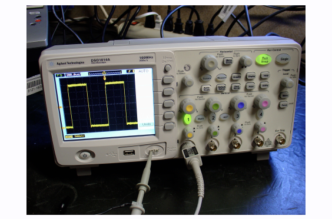
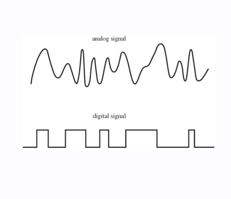
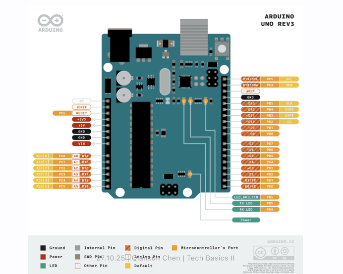
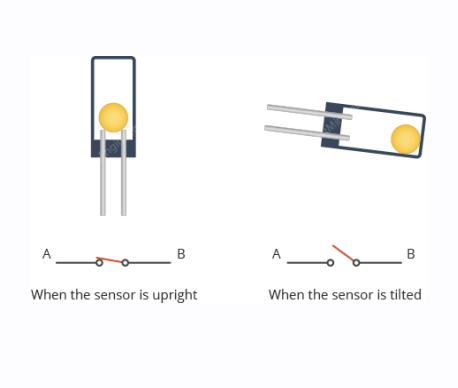
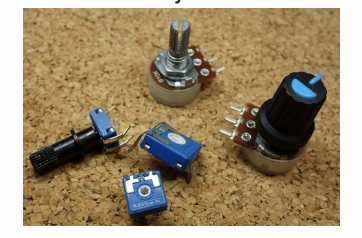
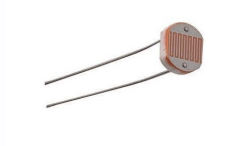

# Week 3 

## I fell sick for week 3, but this is what i learnt after looking at notes from my classmates and our week 3 presentation! There was definetley a lot of new information to catch up on, a little overwhelming at first i have to admit. Still, i think i got the main takeaway of week 3's session and im sure i'll be able to further my knowledge in the next weeks.

## ***A deeper look at analogWrite() and analogRead(). New components including Tilt Switch, Potentiometer and Photoresistor.***
- analogWrite() : PWM (Pulse-Width Modulation, a digital method of controlling analog power by rapidly switching. signal on and off)
- 0-255 "translation", mapping between 0v and 5v (8bits)
- Popular technique in dimming LEDs, controlling motor speed, etc.
- Duty Cycle : the promotion of "on-time" in each cycle
- Oscilloscope : A device that measures voltages ad displays them graphically.

## ***Analog vs Digital Signals***

*Analog signals* are continuous and vary smoothly over time. *Digital signals* are discrete and usually represented by binary states (01)

- Analog pins can also be used for digital output
- Reset button doesn't delete code, it returns in
- TX (transmit), RX(Receive) are reserved for serial communication, usually don't use these 2 pins (can use these pins as normal digital pins id not serial communication is needed)
- 2-13: Digital I/O pins, - for PWM
- A0-5 : Analog Input Pins
- VIN : To power the Arduino UNO (7-12V)
- Reset : Does the same job as reset button
- IOREF : Reference Voltage for all I/O pins, connected to 5v on Arduino UNO

## ***digitalWrite() / digitalRead()***
- HIGH - 5V
- LOW - 0V
- Both Digital and Analog Pins

## ***Tilt Switch***

- A component that can detect the tilting of an object

## ***Serial Print***

### - Serial Baud Rates : 
- Serial baud rates are the number of signal changes per second in a serial communication channel
- The specific rate must be matched between the transmitting and receiving devices for successful communiction
- Most commonly used value for Arduino : 9600 bps

### ***INPUT_PULLUP***
- Internal pull-up resistors in Arduino (connect to power internally)
- Prevents Floating pins (without pull-up/down resistor, unconnected pins "float", picking up electrical noise and returning random values
## ***AnalogRead()***
- Analog pin will give you a value between 0 and 1023 (0 means 0V and 1023 means max. volt (5V by default))
- Only works on Analog pins
## ***ADC***
- Arduino UNO contains 10-bit, 6-channel analog to digital converter (ADC)
- A device that converts an analog signal (voltage) into a digital value
- You can set the AREF (Analog Reference) pin to something lower than 5V for higher resolution for low voltage components
## ***Potentiometer***
- Adjustable Resistor / Most common use : Volume Adjustment

## ***Photoresistor***
- Also knows as "Light-Dependent Resistor(LDR)", a light-sensitive variable resistor whos resistance decreases as the intensity of light hitting surfaces increases
- 

