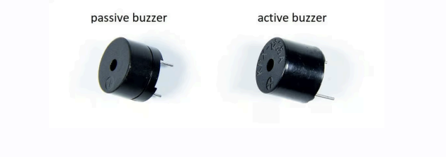
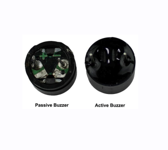
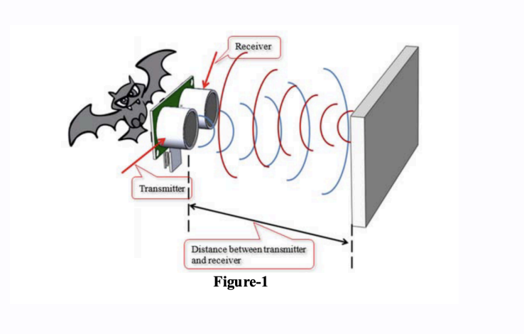

# Week 4 

## Unfortunately, i was also sick in week 4... nevertheless i asked my classmates, looked at the week 4 presentation and found out we learnt about Buttons & Buzzers!

## ***Buzzers***
- Active Buzzer : Can produce sound directly when connected to power (built in oscillator, defined pitch), longer leg is +
- Passive Buzzer : Requires a signal in order to make sound
- Standard soundwave for Arduino/Electronics : Pulse (Sinewave also possible using fade in/fade out)
- Ultrasonic Distance Sensor : Reads legs to know what to connect

  

## ***Buttons***
- Placed on spine/middle line
- Pushing connects the top to bottom line
- Push buttons need a pull-up or pull-down resistor, otherwise pin reads random
- Multimeter is useful debugging tool

- 

