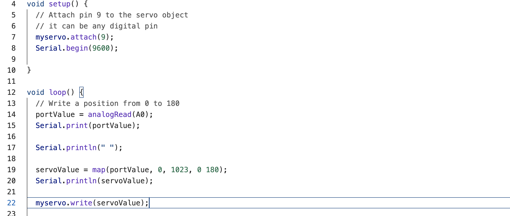
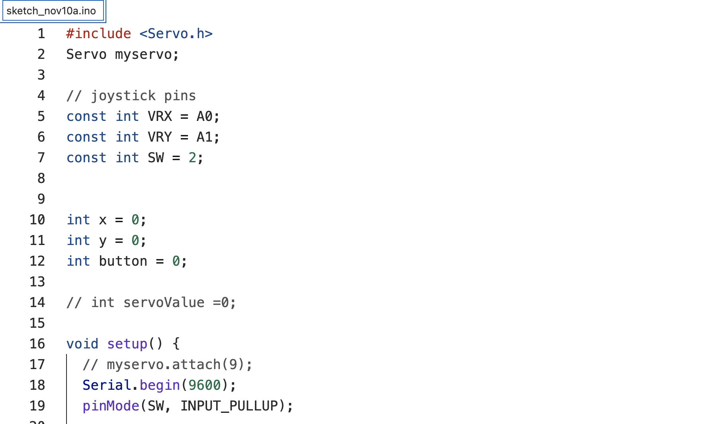
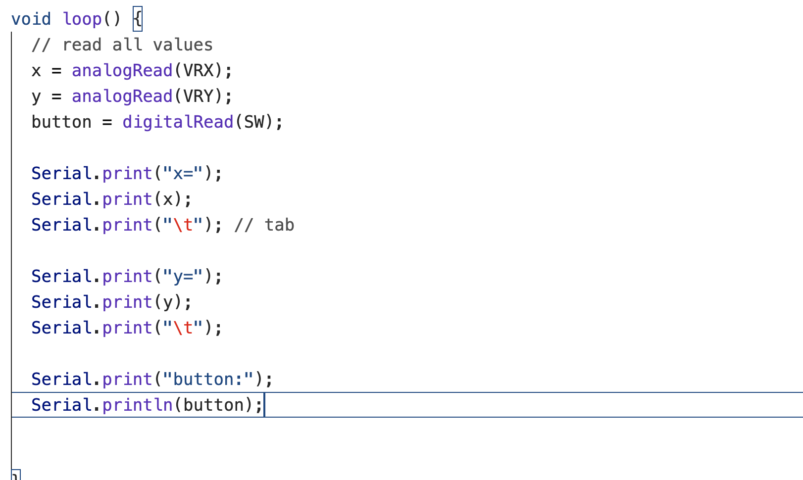

# Week 5 

### In week 5, we looked at Servo Motors, Stepper Motors and DC Motors. The Servo Motor we used from our kit was the SG90. 

## ***Servo*** Motors 
- Can change angle, position and speed. 
- It can rotate between 0-180°.
- It expects a 50Hz PWM signal (roughly one pulse every 20ms) from a controller (Arduino).
- Other common position servos include = MG90s, SG5010, Micro Servo

## ***In Arduino*** :
 - The first step was importing the servo library. 'myservo' declared an object of class servo.
 - If we were to restart our code at a different position on the Servo, it would move differently.
 - analogRead(), map()

   

## ***Servo usages***
- Plotters (x,y axis to hold a pen for instance)
- Can translate this servo movement to create robotics

# Servo Movement Exercises 
